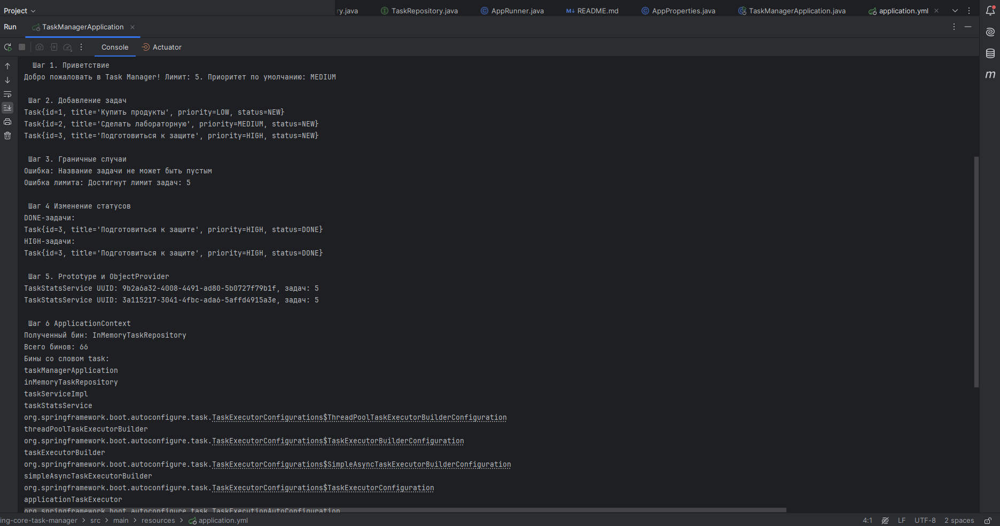
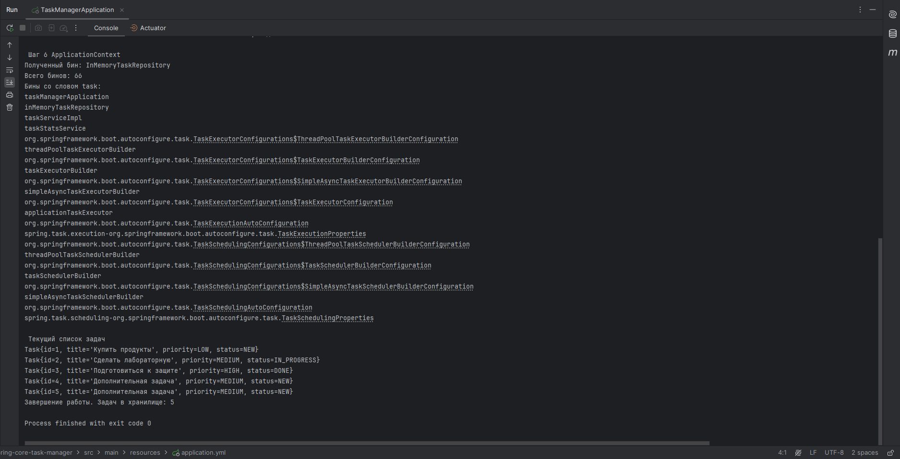
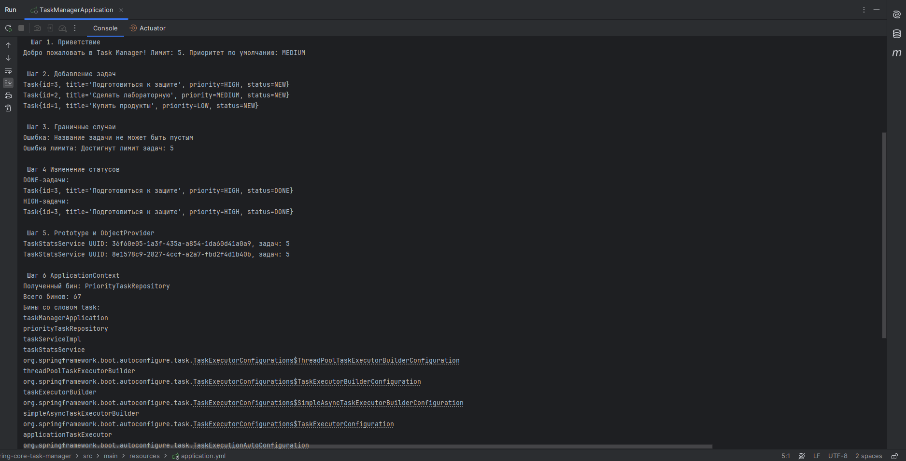
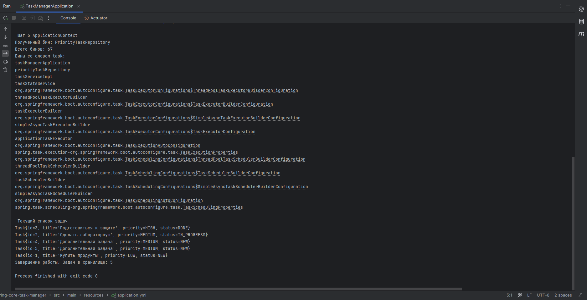

# Spring Core Task Manager

Проект Task Manager на Spring Boot.

Программа работает в консоли. В ней можно создавать задачи, менять их статус и смотреть список задач.

Главная цель работы была разобраться с основными вещами Spring Core:
- Бины;
- Dependency Injection;
- `@Component`;
- `@Bean`;
- `@Primary`;
- `@Qualifier`;
- `@Profile`;
- `@Value`;
- `@PostConstruct`;
- `@PreDestroy`;
- Singleton и Prototype;
- `ObjectProvider`;
- `ApplicationContext`.

---

## Задача

В программе есть класс `Task`.

У задачи есть:

- id;
- название;
- описание;
- приоритет;
- статус.

Приоритет может быть:


LOW
MEDIUM
HIGH


Статус:


NEW
IN_PROGRESS
DONE


---

## Структура проекта

Основные папки проекта:


model
repository
service
config
runner


`model` — находится класс задачи.

`repository` — работа со списком задач.

`service` — основная логика программы.

`config` — настройки Spring.

`runner` — код, который запускается при старте программы.

---

## Репозитории

В проекте есть два репозитория:


InMemoryTaskRepository
PriorityTaskRepository

Оба работают через интерфейс:


TaskRepository


Какой репозиторий будет использоваться, зависит от профиля Spring.

---

## Профиль DEV

В `application.yml` можно выбрать профиль:


spring:
  profiles:
    active: dev


При `dev` используется:


InMemoryTaskRepository


Задачи выводятся в обычном порядке.

Пример работы:





---

## Профиль PROD

Если поменять:


spring:
  profiles:
    active: prod


Будет использоваться:


PriorityTaskRepository


В этом случае задачи сортируются по приоритету:


HIGH
MEDIUM
LOW


Пример работы:






---

## Настройки

Настройки программы находятся в `application.yml`:


app:
  name: Task Manager
  max-tasks: 5
  default-priority: MEDIUM


Они загружаются через `@Value`.

`name` — название программы.

`max-tasks` — максимальное количество задач.

`default-priority` — приоритет, который ставится по умолчанию.

---

## Ограничение задач

Максимально можно создать 5 задач.

Если попробовать создать больше, программа выводит:


Ошибка лимита: Достигнут лимит задач: 5


Также нельзя создать задачу с пустым названием:


Ошибка: Название задачи не может быть пустым


---

## @Primary и @Qualifier

В проекте есть два варианта `TaskRepository`.

`@Primary` говорит Spring, какой вариант использовать по умолчанию.

`@Qualifier` позволяет указать конкретный бин, который нам нужен.


---

## @PostConstruct и @PreDestroy

`@PostConstruct` выполняется после создания бина.

У меня при запуске выводится сообщение о том, что сервис создан.

`@PreDestroy` выполняется перед завершением приложения.

В конце программа выводит:


Завершение работы. Задач в хранилище: 5


---

## Prototype

`TaskStatsService` сделан с:


@Scope("prototype")


Это значит, что Spring может создавать новый объект при каждом запросе.

Чтобы это проверить, программа два раза получает `TaskStatsService`.

Получаются разные UUID:


TaskStatsService UUID: 7711c2da-9271-4ad2-a025-5d30dd98a289

TaskStatsService UUID: 29deb91a-4d35-4642-a4de-6b8e1bc8f95a


Значит это два разных объекта.

Для получения нового объекта используется:


ObjectProvider


---

## ApplicationContext

В программе также используется `ApplicationContext`.

Через него можно получить бин вручную.

Например, при DEV программа выводит:


Полученный бин: InMemoryTaskRepository


А при PROD:


Полученный бин: PriorityTaskRepository


Также программа выводит количество Spring-бинов и бины, в названии которых есть слово `task`.

---

## Что происходит при запуске

После запуска программа сама выполняет несколько действий.

Сначала выводит настройки:


Добро пожаловать в Task Manager!
Лимит: 5.
Приоритет по умолчанию: MEDIUM


Потом создаёт три задачи:


Купить продукты — LOW
Сделать лабораторную — MEDIUM
Подготовиться к защите — HIGH


Потом проверяет ошибки:

```text
пустое название
превышение лимита
```

После этого меняет статусы задач и показывает задачи со статусом `DONE` и приоритетом `HIGH`.

Дальше два раза создаётся `TaskStatsService`, поэтому выводятся два разных UUID.

В конце выводится информация из `ApplicationContext` и список всех задач.

---

## Запуск

Проект можно запустить через IntelliJ IDEA.

Нужно открыть главный класс и нажать:


Run


Также можно запустить через Maven:


mvn spring-boot:run


---

## Что было сделано

В этой работе я сделал простой Task Manager и использовал основные возможности Spring Core:


@Component
@Service
@Configuration
@Bean
@Primary
@Qualifier
@Profile
@Value
@PostConstruct
@PreDestroy
@Scope
ObjectProvider
ApplicationContext
CommandLineRunner


Также сделал два профиля `dev` и `prod`.

В `dev` используется обычный репозиторий, а в `prod` задачи сортируются:


HIGH → MEDIUM → LOW


Программа запускается и все пункты задания работают.